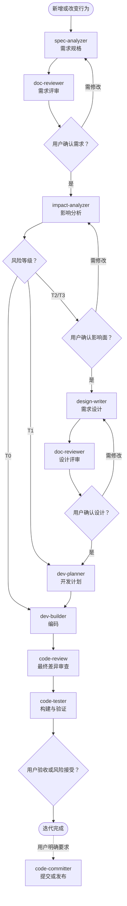
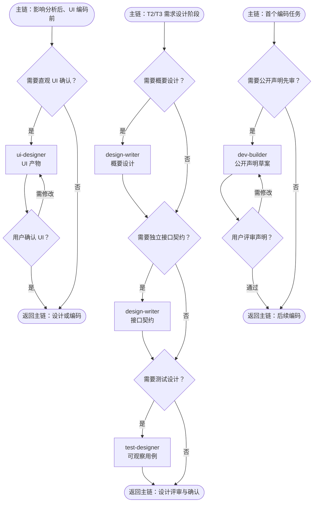
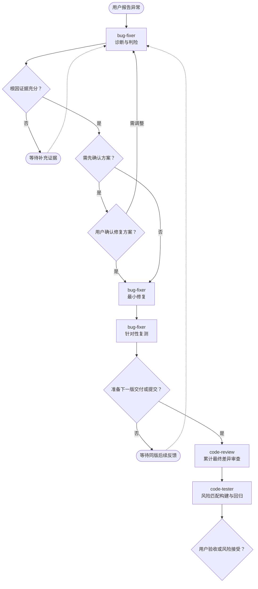

# DevFlow 1.2.0

DevFlow 是一套安装到现有项目目录中的 Claude Code 开发工作流，用于让 AI 面向日常迭代稳定完成开发：不偏离需求、不遗漏影响面、不过度开发，并能在中断后继续执行。项目可以使用 Git、SVN，也可以暂时不使用版本控制。

核心用法：

```text
python scripts/devflow.py install --target "F:\Dev\TargetProject"
重启 Claude Code，使自定义 Skill、子 Agent 和 hooks 生效
Claude 会先恢复状态，并主动汇报当前迭代与下一步
```

Claude Code 会自动加载根目录 `CLAUDE.md` 与 `.claude/CLAUDE.md`，安装后重启即可生效。完整调度规则在 `.claude/CLAUDE.md`，本文档面向人类快速理解。

---

## 一句话定位

```text
按需求规格确认事实、按影响面锁定范围；用 T0-T3 分级控制流程深度，用开发计划逐任务执行，用独立子 Agent 控制编码与审查，用指纹凭据守住提交门禁。
```

## 工作流特点

- **质量优先**：开发前确认需求和影响范围，开发后执行独立审查与验证，减少理解偏差和遗漏。
- **轻重适配**：按 T0-T3 调整流程深度，小改动保持轻量，复杂需求补足影响面和详细设计。
- **尊重项目事实**：优先使用项目文档、现有架构和源码证据，不让 AI 自行推断业务与模块边界。
- **可持续执行**：任务、阻塞和验证状态文件化，跨会话或中途切换后可以继续推进。
- **人工控制关键方向**：需要业务判断的阶段由用户确认，编码、审查和测试尽量自动完成。
- **保护现有项目**：保留用户已有修改和项目定制，升级、审查及提交均有明确保护边界。

## 适用场景

适合由 AI 参与日常迭代的 C/C++、Qt、Web、服务端或混合技术栈项目，尤其适合：

- 需求涉及多个模块、接口、数据、UI 或持久化。
- 开发任务可能跨会话执行或中途切换。
- 希望按风险确认关键文档，后续开发尽量自动推进。
- 需要保留独立代码审查、人工验收和提交门禁。

以下工作不会启动需求迭代：

- 代码解释、方案讨论、只读排查、文档评审和状态查询。
- 不改变既有预期的普通 Bug 修复。
- 纯格式、注释或不改变产品行为的短时维护。

DevFlow 不替代项目管理平台、产品决策和人工验收。一次性脚本、纯探索原型或无须留存状态的极短任务通常无需使用。

## 组成

| 组成 | 用途 |
|---|---|
| `.claude/CLAUDE.md` | 调度入口、等级判断、阶段流转和恢复规则 |
| `.claude/skills/` | 需求、影响面、UI、设计、计划、编码、审查、测试和提交流程 |
| `.claude/agents/` | 独立文档评审、编码与代码审查 Agent |
| `.claude/constraints/` | 默认编码、日志、文档和目录规范；可增加项目约束 |
| `.claude/progress.json` | 当前迭代、任务、阻塞和待办输入 |
| `.claude/hooks/` | 提交前审查覆盖与构建检查 |
| `.claude/scripts/` | 项目模板/约束解析与修改文件的编码检查 |
| `scripts/devflow.py` | 安装、检查和升级 DevFlow |

需求、设计、计划和测试文档生成在目标项目的 `docs/` 中，不由升级工具覆盖。

各类事实分别维护：需求规格保存业务预期，影响面保存真实范围，详细设计保存技术契约，开发计划保存任务与验证当前状态，审查和构建凭据证明最终代码质量，`progress.json` 只负责恢复导航。UI 原型按需写入 `docs/05-UI/原型/<迭代ID>/`。

## 流程分级

等级按业务影响、技术契约风险和失败后果判断，不按文件或函数数量判断。

| 等级 | 典型场景 | 默认流程 |
|---|---|---|
| T0 | 极小修改或不接入既有业务的独立新增 | 需求确认、简要影响、编码、独立审查、最小验证；可省略计划 |
| T1 | 同模块局部行为变化，模式清楚 | 需求确认、简要影响、计划、编码、独立审查、验证 |
| T2 | 跨模块、接口/数据、持久化、复杂 UI 或线程 | 需求、独立影响面、按需 UI、需求设计、计划、编码、独立审查、验证 |
| T3 | 跨工程协议、迁移、安全或不可逆变更 | T2 主链，默认增加独立概要设计并加深兼容、回退和验证 |

T0/T1 默认不生成详细设计，只有需求规格一次开发前硬确认；简要影响写回现有产物并建议查阅。T2/T3 分别确认需求、影响面和设计；按需 UI 产物在原有 UI 确认门处理。等级由影响和风险决定，不因文件多、函数多或需求项多自动升档。

## 工作入口

| 输入意图 | 进入的流程 | 首先确认的事实 |
|---|---|---|
| 新增或改变行为、接口、数据、UI、配置规则 | 需求开发主链 | 目标、现有行为、验收与影响范围 |
| 保持已确认预期，改进实现、性能、依赖或构建方式 | 技术改造（复用分级开发链） | 技术目标、不变边界和验证基线 |
| 当前行为偏离已确认预期 | Bug 修复子流程 | 既有预期、失败信号、根因证据 |
| 解释、评估或只读排查 | 只读处理 | 所需信息和证据范围 |

入口根据目标与已确认预期判断，不凭“Bug”“优化”“重构”等词触发。预期不明时先查需求、契约、测试和项目事实；仍不明再问用户。一次输入混有新功能和 Bug 时拆为关联工作项，不把新功能塞进修复批次。

## 主流程

需求开发沿用一条 T0–T3 主链。下图只画默认执行链；按需增强和 Bug 修复分别见后续图示。图中的执行节点以 Skill 命名，菱形表示原有确认门或分级判断。T0/T1 只有需求确认这一道默认的开发前硬确认；T2/T3 再分别确认独立影响面和设计。`doc-reviewer` 在原需求、设计确认门前检查，不增加确认次数。失败只回到真正失效的阶段，不重走仍有效的前置结论。



需求有影响行为或验收的歧义时，`spec-analyzer` 逐题澄清并保留关键假设；输入明确时跳过访谈。复杂迭代按“目标 → 按需需求组 → 可验收的 `REQ`”组织。T0/T1 的简要影响写回需求规格，T2/T3 的独立影响面获确认后才进入设计和计划。开发计划将编码列为 `TASK`，将构建、测试、审查和用户验收列为 `VERIFY`。所有代码交付都要独立审查及与风险匹配的验证；提交和发布不属于迭代完成条件，只在用户明确要求时执行。

## 补充流程（按需增强）

增强节点按风险和用户选择插入主链，跳过时不增加产物或确认门。T0/T1 需要直观 UI 确认时，也在 UI 编码前插入 `ui-designer`；T2/T3 在影响面确认后、设计前插入。概要设计和接口契约由 `design-writer` 在同一设计阶段按需补充，测试设计在设计评审前接入。公开声明先审属于首个编码任务中的条件节点。



图中的三个入口分别表示插入主链的时机，不要求所有增强节点依次执行。T3 默认产出概要设计；T2 仅在多对象或跨边界协作需要时产出。

### 增强节点启用条件

| 节点 | 何时启用 | 写入何处或如何确认 |
|---|---|---|
| UI 设计 | 新页面，或布局、视觉层级、组件形态、交互路径需要直观确认 | UI 产物在原 UI 确认门处理；简单字段或文案变化可复用现有界面 |
| 概要设计 | T3 默认；T2 在多对象或跨边界协作需要时 | 独立概要设计，与需求设计及契约同次确认 |
| 接口契约 | 跨进程、跨工程、独立发布或不同维护方消费的通信边界变化 | 维护方与消费方在原设计确认门确认；REST 字段说明位置、单位、错误及无结果时的 `[]` / `null` |
| 公开声明先审 | 独立消费方需先依据头文件/IDL 开发，或公共类型语义风险高 | 先评审声明草案，再实现转换、后端和 UI；普通 REST 变化不触发 |
| 测试设计 | 关键逻辑、复杂映射、高回归风险或用户选择；T3 必须说明测试层级 | 可选 `test-designer` 在设计确认前补用例；单元测试不强制，未选用时写替代验证 |

### TDD（可选）

`test-designer` 在编码前设计可观察用例：T2/T3 写入设计草稿，无详设时写入开发计划；它不编写或运行测试代码。选用 TDD 后，`dev-planner` 将测试与实现放入同一行为 `TASK`，`dev-builder` 逐个行为执行红（失败测试）→ 绿（最小实现）→ 重构并复测，不预先批量编写测试。交付前仍由 `code-tester` 执行选定验证；未选 TDD 时按项目常规方式实现和验证。

每个编码任务重新核对同层同类实现、注册/转换机制、权威类型及文件编码；任务结束和交付前检查本次修改文件的编码、BOM、行尾和项目格式。审查与验证凭据必须覆盖最终待交付差异。

## Bug 修复子流程

用户主动报告异常时，无论是否使用“Bug”一词，都先核对**已确认预期 → 失败信号 → 根因证据 → 影响与复测范围**。无法可靠定位时先收集证据，不猜测性修改。若修复会改变原预期，该问题经用户确认后转入需求开发。



开发任务内自动发现的失败沿原任务修复，不增加确认门。用户报告的每个问题先诊断：根因清楚、范围局部且可验证的低风险修复可直接执行并报告；预期或根因不清、高风险，或用户要求先看方案时，先说明分析和拟改范围，获确认后再修改。根因或范围实质变化需重新判险。

初版交付后，同一测试版本的多轮反馈共用一个修复批次；优先复用现有问题清单，没有时使用 `docs/06-测试/<批次ID>-修复批次.md`。每个 `BUG-xxx` 只做针对性复测；公共声明、接口或构建配置变化在交给联调方前构建受影响目标。下一版交付或用户要求提交前，对累计最终差异统一审查、构建和回归。新功能进入待办，不混入本批次；提交或推送仍需用户明确要求。

## 其他入口

**技术改造**用于重构、依赖更新、构建调整等功能预期不变的工作。先明确技术目标、不变行为和验证基线，再按 T0–T3 风险等级复用影响分析、按需设计、编码、审查和验证；不生成需求规格或专用基线文档。若实际需要改变功能预期，转入需求开发。

**只读处理**用于咨询、评估和排查，不启动迭代；用户要求实施后再选择相应入口。

## 安装

要求 Python 3.10+。安装器会自动识别目标目录是 Git、SVN 还是无版本控制项目，不会初始化或转换版本控制。在 DevFlow 仓库中先预览，再安装：

```powershell
python scripts/devflow.py install --target "F:\Dev\TargetProject" --dry-run
python scripts/devflow.py install --target "F:\Dev\TargetProject"
```

无人值守安装：

```powershell
python scripts/devflow.py install --target "F:\Dev\TargetProject" --yes
```

目标目录本身是普通 Git 工作树根时默认配置 `.claude/hooks`，`--dry-run` 会同时预览该配置；Git monorepo 子项目、linked worktree、SVN 和无版本控制目录自动跳过。Git 仓库根不希望修改 `core.hooksPath` 时增加 `--no-hooks`。安装器不复制 `settings.local.json`，本机工具权限继续由项目使用者自行维护。安装完成后重启 Claude Code。

Git 仓库根启用 DevFlow hook 后，提交检查会按暂存文件向上匹配最近的 DevFlow 项目；嵌套项目分别使用各自的评审和构建凭据。已完整评审的文件集合允许只提交其中一部分；构建凭据必须与当前暂存文件集合及内容完全一致，暂存范围变化后需要重新构建。删除整个嵌套 DevFlow 项目时，其删除范围归入最近的存活父项目。

## 升级

推荐先检查，再正式升级；`check` 已经提供完整预览，不需要再机械重复一次 `update --dry-run`：

```powershell
python scripts/devflow.py check --target "F:\Dev\TargetProject"
python scripts/devflow.py update --target "F:\Dev\TargetProject"
```

`check` 默认只显示结论和需要处理的 `ADD / UPDATE / DELETE / CONFLICT / CONFIG`，已是最新状态时只输出简短的 `[OK]` 结论；使用 `--verbose` 才显示全部 `KEEP` 文件和正常 hook 状态。

自动化环境只需要预览退出码时，可直接使用 `update --dry-run`。

默认升级会：

- Git 项目将 `.claude` 备份到 Git 元数据目录的 `devflow-backups/`；SVN 和无版本控制项目备份到目标目录外的 `<项目名>-devflow-backups/`。可用 `--backup-dir` 统一改位置。
- 更新未被修改的 DevFlow 文件，并清理未定制的废弃文件。
- 保留项目定制和冲突文件，并返回退出码 `2`。
- 迁移 `progress.json`，保留当前迭代和历史状态。
- 保留 `.review-status.json`、`.build-status.json`、`settings.local.json` 和项目 `docs/`。
- 仅当目标目录本身是普通 Git 工作树根时检查并设置 `core.hooksPath=.claude/hooks`；`check` 与 `update --dry-run` 对该配置使用一致的预览和退出码；Git 子项目、linked worktree 及其他模式跳过。
- 在备份和写入任何受管文件之前校验目标 `progress.json`；非法 JSON 会在 `validate` 阶段停止，并明确报告文件、行列和“未修改文件”。

安装或升级失败时，输出统一的 `[FAILED]` 结果块，包含失败阶段、目标目录、原因、文件是否可能已变化、已创建的备份路径和恢复建议。升级已完成文件更新但仍有定制冲突时输出 `[ATTENTION]`，不与执行失败混淆。

常用参数：

| 参数 | 用途 |
|---|---|
| `--target PATH` | 指定目标项目目录；支持 Git、SVN 或无版本控制 |
| `--dry-run` | 仅预览，不修改文件 |
| `--force` | 备份后覆盖冲突的受管文件，不覆盖运行状态 |
| `--backup-dir PATH` | 指定备份目录 |
| `--yes` | 跳过交互确认 |
| `--verbose` | 显示未变化文件 |
| `--no-hooks` | Git 项目不检查或配置 `core.hooksPath` |

查看完整帮助：

```powershell
python scripts/devflow.py --help
python scripts/devflow.py install --help
python scripts/devflow.py check --help
python scripts/devflow.py update --help
```

## 项目模板与约束定制

最直接的定制方式是保留原路径，编辑或替换 `.claude/skills/*/references/` 下的模板和 `.claude/constraints/` 下的默认约束。例如直接修改 `需求规格_模板.md`，下次生成需求规格就读取修改后的内容；可调整章节和措辞，但要保留 `REQ-`、`AC-`、来源、状态等追溯语义，或提供经确认的等价表示。新增约束写成 `.claude/constraints/` 下的 Markdown 文件；DevFlow 启动时扫描文件清单，按标题和适用范围在相关阶段加载。新文件范围不明或与现有规则冲突时会说明来源与影响，请用户确认；确认后在适用范围内优先使用注入文档。

```powershell
python .claude/scripts/project_config.py --root . scan
```

直接修改的默认模板或约束属于受管文件，升级预览会标为冲突并保留，随后需人工合并新版规则。希望定制文件不受升级冲突影响时，可在目标项目根使用可选的 `devflow.project.json` 指向项目自有文件：

```json
{
  "templates": {
    "requirement_spec": "docs/devflow/templates/spec.md"
  },
  "constraints": {
    "coding": {"mode": "extend", "path": "docs/devflow/rules/coding.md"}
  }
}
```

模板键：`requirement_spec`、`impact_analysis`、`requirement_design`、`overview_design`、`interface_contract`、`module_design`、`architecture`、`development_plan`、`repair_batch`、`code_review`。约束键：`coding`、`logging`、`document`、`directory`。模板路径直接替换该类默认模板；约束的 `extend` 先读默认文件再读项目文件，`replace` 仅读项目文件。路径使用项目内相对路径和 `/`，文件放在受管 `.claude` 外；配置和引用文件不会被 DevFlow 升级覆盖。`replace` 不取消用户确认、证据真实性和提交授权门禁。

```powershell
python .claude/scripts/project_config.py --root . validate
python .claude/scripts/project_config.py --root . resolve --kind template --name requirement_spec
```

同路径替换和配置指向的模板应保留稳定 ID、来源或关联、状态及追溯语义；若改用等价结构，由用户确认后按该结构生成。`validate` 汇总配置警告，`scan` 不依赖配置，`resolve` 只校验当前使用项：无关错误不阻断当前节点；当前文件不可读取时只暂停该产物并提示用户修正或选择；可读取但缺少预期锚点时提示用户确认语义，不自动换回默认模板。提交授权、证据真实性和原确认门保持有效。未配置的项目沿用同路径文件。升级完成后需要重启 Claude Code。

## 手动升级

没有 Python 环境时，先备份目标项目 `.claude`，再按下表拷贝：

| 处理方式 | 文件 |
|---|---|
| 确认未定制后替换 | `.claude/CLAUDE.md`、`.claude/.gitignore`，以及 `agents/`、`skills/`、`hooks/`、`scripts/` 中 DevFlow 提供的同名文件；已改动的受管文件先保留并人工合并，保留项目额外文件 |
| 比较后替换 | `.claude/constraints/`；未做项目定制可直接替换，已定制则保留并合并新规则 |
| 必须保留 | `.claude/progress.json`、`.claude/settings.local.json`、`.claude/.review-status.json`、`.claude/.build-status.json`、项目根 `CLAUDE.md`、`devflow.project.json` 及其引用文件和 `docs/` |
| 删除旧文件 | `.claude/skills/design-maker/SKILL.md`、`.claude/skills/ui-designer/references/qt-frontend.md`、`.claude/skills/ui-designer/references/web-frontend.md`；界面设计能力由新版 `ui-designer` 提供 |

`pre-commit-check.ps1` 使用新文件同名覆盖，不保留版本后缀脚本。Git 项目可执行 `git config core.hooksPath .claude/hooks`；SVN 和无版本控制项目跳过此步。最后重启 Claude Code。

手动合并和状态迁移完成后再更新 `.claude/devflow-version.json`；直接复制新版清单不会证明目标项目的受管文件已经更新。

除非明确不需要项目定制和历史状态，不建议直接覆盖整个 `.claude`。日常升级优先使用 `devflow.py update`，手动拷贝仅作为兜底方式。
